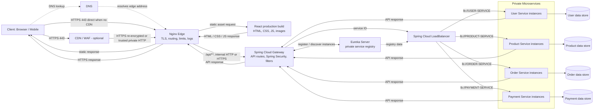

# Bài 5: Phân tích kiến trúc — API Gateway và Reverse Proxy

> **Phạm vi:** Workspace hiện có các bài thực hành Nginx và cấu hình tham khảo, nhưng không có mã nguồn React/Spring, cấu hình Eureka, route Gateway hay JWT policy. Tên dịch vụ và luồng dưới đây là mô hình theo đề bài, không được khẳng định là đã triển khai. Domain, IP, chứng chỉ và secrets đều là ví dụ; không đưa JWT secret/private key/credentials vào repository.

## 1. Vấn đề kiến trúc

Spring Cloud Gateway và Nginx đều có thể nhận HTTP request, chọn upstream và proxy request/response. Đây là phần giao nhau về cơ chế, không có nghĩa chúng là cùng một thành phần trong kiến trúc.

Trong mô hình tham khảo, Nginx nằm ở **Edge Network**, nhận lưu lượng từ Internet và xử lý các trách nhiệm web/edge. Spring Cloud Gateway nằm ở **application layer**, hiểu route API và tích hợp với hệ sinh thái Spring, Service Discovery và chính sách ứng dụng. Mục tiêu không phải thêm một proxy theo thói quen, mà phân chia trách nhiệm, giảm mức phơi bày và chọn đúng công cụ cho từng công việc.

## 2. Vai trò của Nginx tại Edge

### 2.1 TLS termination

Nginx nhận HTTPS từ trình duyệt/mobile tại cổng `443`, dùng chứng chỉ server để hoàn tất TLS, sau đó chuyển tiếp request tới Gateway trên mạng nội bộ. Tập trung TLS tại Edge giúp quản lý chứng chỉ, cấu hình TLS, HTTP redirect và logging ở một ranh giới rõ ràng; các instance Gateway phía sau có thể tập trung vào xử lý API.

Nginx-to-Gateway có thể dùng HTTP khi hai tiến trình ở cùng host/loopback hoặc trên mạng riêng được kiểm soát theo threat model. Nếu traffic đi qua mạng không tin cậy, giữa các vùng bảo mật, hoặc có yêu cầu compliance/zero-trust, nên mã hóa chặng nội bộ bằng HTTPS và cân nhắc mTLS, xác minh certificate/identity, quản lý rotation và bảo vệ key. TLS tại Edge không tự động mã hóa các hop bên trong.

### 2.2 React production build và static assets

React production build là các file tĩnh (HTML, CSS, JavaScript, hình ảnh). Nginx có thể đọc trực tiếp từ filesystem/CDN origin, trả file hiệu quả, thiết lập cache phù hợp cho file có hash và nén nội dung text. Các request này không cần đi qua JVM Gateway.

React development server khác production build: nó phục vụ hot-module replacement, source map và luồng phát triển. Proxy tới dev server phù hợp local/dev; production thông thường phục vụ build tĩnh qua Nginx/CDN hoặc một static hosting service. Nếu kiến trúc dùng frontend server riêng, Nginx có thể proxy tới server đó.

### 2.3 Bảo vệ và kiểm soát tại Edge

- Nginx Open Source cung cấp các cơ chế như `limit_req` và `limit_conn` để hạn chế tốc độ request/kết nối theo cấu hình; `client_max_body_size` giới hạn request body; timeout và giới hạn buffer giúp kiểm soát tài nguyên.
- Có thể từ chối một số method/host/path bất thường, chuẩn hóa header, áp dụng allow/deny theo nhu cầu và ghi access/error log ở lớp Edge.
- Rate limiting là giới hạn lưu lượng theo policy, không phải giải pháp chống mọi DDoS. Tấn công volumetric cần CDN, WAF, dịch vụ chống DDoS và năng lực mạng/nhà cung cấp phù hợp. Nginx đơn lẻ không thể chặn lưu lượng đã làm nghẽn đường truyền trước khi tới máy chủ.
- Nếu Nginx đứng sau CDN/load balancer, `$remote_addr` có thể là địa chỉ proxy phía trước. Chỉ cấu hình Real IP từ các dải proxy đáng tin cậy; không tin `X-Forwarded-For` tùy ý từ Internet.
- Các tính năng nâng cao như active health checks, API quản trị/metrics và một số tính năng JWT có thể phụ thuộc NGINX Plus hoặc sản phẩm/module bổ sung. Không mặc định chúng có trong Nginx Open Source.

### 2.4 Reverse proxy và phân phối tải

Nginx quản lý kết nối phía client và kết nối tới upstream, route HTTP theo host/path, và có thể cân bằng tải giữa các Gateway instance. Nginx Open Source có khả năng upstream/load balancing với health/failure behavior phù hợp phiên bản/cấu hình; active health check và một số khả năng quản trị nâng cao là khác biệt của NGINX Plus.

Nginx phù hợp các tác vụ edge nhiều kết nối nhờ kiến trúc event-driven và triển khai gọn. Điều đó không chứng minh Nginx luôn nhanh hơn Spring Cloud Gateway trong mọi workload. So sánh thực tế phải xét TLS, payload, filter, logging, số kết nối, CPU/RAM, JVM tuning, network và benchmark đại diện tải.

## 3. Vai trò của Spring Cloud Gateway

### 3.1 Định tuyến API theo nghiệp vụ

Gateway có thể chọn route bằng path, HTTP method, host, header, query hoặc các predicate khác. Ví dụ:

- `/api/users/**` → User Service.
- `/api/products/**` → Product Service.
- `/api/orders/**` → Order Service.
- `/api/payments/**` → Payment Service.

Route giúp client dùng một API entry point thay vì biết địa chỉ từng service. Gateway có thể áp dụng filter/rewriting theo route. Cần thống nhất prefix: cấu hình Nginx bên dưới giữ nguyên `/api/...` khi proxy; predicate ở Gateway phải khớp prefix đó. Nếu service phía sau mong URI không có `/api`, thực hiện rewrite/strip prefix tại Gateway theo contract đã chọn.

### 3.2 Spring Security, JWT và quyền truy cập

Spring Cloud Gateway có thể tích hợp Spring Security, xác thực JWT bằng chữ ký/issuer/key phù hợp, thời hạn và các claim cần thiết; policy có thể dựa trên scope/role. Cần phân biệt:

- **Authentication (xác thực):** token hợp lệ thuộc về ai/client nào?
- **Authorization (phân quyền):** chủ thể đó được phép thực hiện hành động trên tài nguyên nào?

Gateway có thể chặn request chưa xác thực hoặc áp dụng policy dùng chung. Tuy nhiên, không phải mọi logic bảo mật buộc phải đặt tại Gateway. Service nghiệp vụ vẫn nên xác minh quyền trên tài nguyên của mình, đặc biệt kiểm soát quyền sở hữu order/user/payment; đây là defense in depth.

Nếu Gateway truyền thông tin danh tính tới service bằng header, phải bỏ/ghi đè header do client tự gửi và chỉ tin metadata từ Gateway đã xác thực qua kênh mạng đáng tin cậy hoặc cơ chế ký/mTLS. Không chuyển tiếp JWT/claim một cách thiếu kiểm soát.

### 3.3 Eureka và Service Discovery

Eureka Server lưu registry các instance: service đăng ký khi khởi động và cập nhật/hủy đăng ký theo vòng đời. Gateway tích hợp DiscoveryClient có thể khám phá instance; Spring Cloud LoadBalancer chọn instance khi route dùng `lb://PRODUCT-SERVICE`.

Ví dụ `lb://` chỉ hoạt động khi service ID khớp registry, Eureka client/discovery đã cấu hình, Spring Cloud LoadBalancer dependency có mặt và phiên bản Spring Cloud tương thích. Eureka cung cấp thông tin khám phá; nó không tự proxy request.

Nginx có thể proxy tới địa chỉ upstream cố định hoặc upstream Gateway pool, nhưng cấu hình một địa chỉ cố định không tự nhận biết instance microservice mới đăng ký vào Eureka. Khi instance đổi/thêm, Gateway dùng discovery/load balancing phù hợp có thể cập nhật lựa chọn theo registry/cache/health behavior. Nginx có thể phân phối request tới nhiều Gateway node, không nhất thiết chịu trách nhiệm khám phá từng business service.

### 3.4 Gateway Filter

Global Filter và route-specific Gateway Filter có thể ghi metadata, tạo/duy trì correlation ID, đo thời gian, chuẩn hóa request/response, áp dụng policy xác thực và xử lý cross-cutting concerns ở API layer. Correlation ID cần được validate/replace khi không tin cậy, rồi truyền nhất quán qua downstream để truy vết.

Không biến Gateway thành nơi chứa nghiệp vụ phức tạp, truy cập database nghiệp vụ hoặc mọi policy riêng của từng service. Gateway quá nhiều trách nhiệm trở thành điểm nghẽn, khó release và điểm lỗi tập trung.

## 4. So sánh Nginx và Spring Cloud Gateway

| Tiêu chí                 | Nginx Open Source / NGINX Plus                                                              | Spring Cloud Gateway                                                 | Nhận xét                                                                   |
| ------------------------ | ------------------------------------------------------------------------------------------- | -------------------------------------------------------------------- | -------------------------------------------------------------------------- |
| 1. Vai trò chính         | Web server, edge reverse proxy, static file server, upstream load balancer                  | API Gateway ở tầng ứng dụng                                          | Vai trò chính khác nhau dù cùng proxy HTTP.                                |
| 2. Vị trí                | Edge/DMZ, trước application tier                                                            | Sau Edge, trước microservices                                        | Tùy triển khai có thể gộp hoặc thay bằng managed service.                  |
| 3. SSL/TLS termination   | Rất phù hợp nhận TLS, certificate và redirect ở Edge                                        | Có thể terminate TLS bằng Netty/JVM                                  | Chọn theo ranh giới bảo mật, certificate ops và topology.                  |
| 4. Static assets         | Phục vụ trực tiếp hiệu quả, hỗ trợ cache                                                    | Có thể trả/proxy nhưng không phải mục tiêu tối ưu chính              | Production React build thường ở Nginx/CDN/static host.                     |
| 5. Rate limiting         | `limit_req`/`limit_conn` trong OSS; policy theo cấu hình                                    | Filter/RequestRateLimiter, thường cần backing store cho phân tán     | Cần thiết kế key, đồng bộ nhiều instance và tránh coi là DDoS protection.  |
| 6. Bảo vệ Edge           | Body size, connection/timeout, host/path/method controls, logs                              | Bảo vệ ở application/API layer                                       | WAF/DDoS chuyên dụng hoặc Plus/module là sản phẩm riêng.                   |
| 7. Định tuyến URL        | Host/path và các rule Nginx                                                                 | Path cùng nhiều route predicates                                     | Cả hai làm được routing HTTP cơ bản.                                       |
| 8. Định tuyến nghiệp vụ  | Hạn chế, thường cấu hình static hoặc map                                                    | Route theo API/service, predicates và filters                        | Gateway phù hợp hơn với service semantics.                                 |
| 9. Xác thực JWT          | OSS không có xác thực JWT tích hợp tổng quát; Plus/module hoặc external auth có thể bổ sung | Tích hợp Spring Security Resource Server/JWT thuận tiện              | Xác thực tập trung không thay authorization tại service.                   |
| 10. Spring Security      | Không tích hợp trực tiếp                                                                    | Tích hợp tự nhiên trong ứng dụng Spring                              | Một số tính năng tương đương Nginx Plus/module không phải Spring Security. |
| 11. Eureka               | Không tích hợp Eureka-native trong OSS                                                      | DiscoveryClient có thể dùng registry Eureka                          | Nginx upstream cố định không tự theo Eureka registry.                      |
| 12. Custom Filter        | Directives, maps, njs/Lua/module tùy build; không phải Java filter chain                    | Global/route filters bằng Java/Reactive APIs                         | Filter ứng dụng phức tạp thường dễ đặt ở Gateway.                          |
| 13. Cân bằng tải         | HTTP upstream, static/dynamic capability tùy edition                                        | `lb://` qua Spring Cloud LoadBalancer và discovery                   | Có thể Nginx cân bằng Gateway, Gateway cân bằng business services.         |
| 14. Hiệu năng/tài nguyên | Event-driven, gọn cho web/edge; TLS/static I/O phù hợp                                      | JVM/Reactor Netty; cần heap, GC và tuning nhưng mang logic ứng dụng  | Không kết luận tuyệt đối; đo với workload và cấu hình thật.                |
| 15. Mở rộng              | Thêm Nginx node phía sau LB/CDN; đồng bộ config/cert                                        | Thêm Gateway replica; health, registry, session/state cần tính tới   | HA đòi hỏi thiết kế xung quanh từng thành phần.                            |
| 16. Quan sát/logging     | Access/error log; metrics tùy exporter/edition                                              | Spring Actuator/Micrometer/tracing và application logs               | Chuẩn hóa correlation ID và tránh log token/dữ liệu nhạy cảm.              |
| 17. Độ phức tạp vận hành | Cấu hình gọn, nhưng cert, reload, upstream và edge policy cần quản lý                       | Dependency/version, JVM, security/filter, discovery và release       | Hai lớp thêm thành phần nhưng có thể tách trách nhiệm rõ hơn.              |
| 18. Trường hợp phù hợp   | Edge, TLS, static assets, web proxy, traffic shaping                                        | API routing, authn/authz integration, discovery, application filters | Chọn theo yêu cầu, không theo khẩu hiệu “một proxy là đủ”.                 |

NGINX Plus là bản thương mại với một số khả năng nâng cao như active health checks, API quản trị/dynamic configuration, dashboard/metrics và JWT module tùy phiên bản/license. Nginx Open Source vẫn có reverse proxy, upstream load balancing, rate/connection limiting và logging, nhưng không có mọi tính năng Plus. WAF của NGINX App Protect hoặc dịch vụ WAF/CDN cũng không đồng nghĩa Nginx OSS tự có WAF đầy đủ.

## 5. Data Flow kiến trúc đề xuất

Sơ đồ đầy đủ nằm ở [architecture.mmd](architecture.mmd) và được nhúng dưới đây. CDN/WAF là tùy chọn; nếu không dùng, client kết nối trực tiếp tới Nginx. Chặng Nginx → Gateway có thể HTTP trên loopback/mạng tin cậy hoặc HTTPS/mTLS theo threat model. Các dịch vụ và database chỉ minh họa, chưa được xác minh trong source.



## 6. Phản biện quan điểm bỏ Nginx

### Luận điểm 1: “Spring Cloud Gateway đã làm reverse proxy nên không cần Nginx”

Gateway proxy được yêu cầu API và biết application routes; Nginx cũng reverse proxy được HTTP. Chức năng chồng lấn này là lựa chọn kiến trúc, không chứng minh hai lớp có cùng mục đích. Nginx có thể giữ TLS/static/edge traffic; Gateway giữ route API, security integration, Eureka và filter ở tầng ứng dụng. Nếu CDN/load balancer hoặc một sản phẩm khác đã đảm nhiệm Edge, có thể bỏ Nginx; điều cần tránh là xóa lớp mà không thay thế các trách nhiệm nó đang gánh.

### Luận điểm 2: “Bỏ Nginx sẽ tiết kiệm tài nguyên”

Bỏ một process giảm cấu hình, patching, monitoring và vận hành. Đây là lợi ích thật nếu Gateway hoặc platform còn lại đảm nhiệm tốt TLS, static assets, traffic limits, logs, health và HA.

Ngược lại, Gateway có thể phải nhận toàn bộ kết nối Internet, phục vụ tài nguyên tĩnh và xử lý các nhiệm vụ edge vốn có thể giao cho web server/CDN. Khi đó JVM có thêm tải, bề mặt public lớn hơn và scale có thể phải theo traffic static lẫn API. Không thể kết luận tổng CPU/RAM hoặc chi phí sẽ giảm/tăng bao nhiêu nếu chưa đo. Hãy so sánh trên workload đại diện, gồm TLS, payload, cache, concurrency, logging, failure/scale behavior và tổng chi phí vận hành.

### Luận điểm 3: “Mở port 80 trực tiếp cho Spring Cloud Gateway là đủ”

Port `80` là HTTP thuần, không tự cung cấp mã hóa. Production cần HTTPS trên `443` hoặc một terminator đáng tin cậy phía trước; redirect ở port 80 chỉ đưa client sang HTTPS, không biến request ban đầu thành TLS. Public Java Gateway trực tiếp cũng làm ứng dụng chịu trách nhiệm TLS/cert rotation, kết nối Internet, body/timeouts, static assets, rate limits và traffic bất thường.

Gateway có thể được thiết kế để public nếu đáp ứng đầy đủ yêu cầu, scale, hardening, observability và HA. Nhưng “mở port 80 là đủ” bỏ qua bảo mật truyền tải và vận hành. Microservices, Eureka và database không nên public nếu không có nhu cầu được phê duyệt.

### Luận điểm 4: “Nginx và Spring Cloud Gateway bị trùng chức năng”

Phần giao nhau: nhận request HTTP, chọn route, proxy tới upstream, có thể cân bằng tải và thêm header. Phần bổ sung: Nginx tập trung vào TLS/HTTP/static/connection handling ở Edge; Gateway hiểu service discovery và chính sách API/Spring. Cần tránh lặp cùng một logic nghiệp vụ ở cả hai, hoặc tạo hai lớp rate limit/rewrite mâu thuẫn.

**Kết luận có điều kiện:** Với E-commerce Microservices có nhiều service, Eureka, JWT và React static assets, Nginx Edge kết hợp Spring Cloud Gateway thường phân tách trách nhiệm hợp lý. Với hệ thống nhỏ, static hosting/CDN, cloud load balancer/WAF hoặc managed API Gateway có thể thay một hay cả hai lớp. Quyết định phải dựa vào ranh giới bảo mật, HA, yêu cầu vận hành, năng lực đội ngũ và số liệu tải thực tế.

## 7. Kiến trúc production tham khảo

1. Public DNS trỏ tới CDN/WAF hoặc public load balancer/Nginx; chỉ publish `80/443` cần thiết. `80` có thể dùng redirect/ACME challenge; API/frontend production phục vụ HTTPS.
2. Nginx hoặc managed Edge kết thúc TLS, route `/api/` tới Gateway pool và phục vụ React build tĩnh trực tiếp/CDN. Nếu Nginx đứng sau proxy, chỉ tin forwarded IP/proto từ proxy đã allowlist.
3. Gateway replicas nằm trong private subnet, validate JWT và áp dụng API policy; route business service qua Eureka/DiscoveryClient + Spring Cloud LoadBalancer.
4. Eureka chỉ cho Gateway/services được phép truy cập; không expose registry công khai. User/Product/Order/Payment services và database chỉ nằm trong private network, chỉ nhận traffic từ caller được phép.
5. Đặt connect/read/send timeout, request/body limits, rate/concurrency limits và health checks phù hợp với SLA/endpoint; không đặt timeout ngắn làm hỏng request thanh toán hợp lệ.
6. Dùng correlation ID xuyên suốt, access/error logs, metrics và distributed tracing; không ghi access token, password, payment data hay private information vào log.
7. HTTPS tại Edge là tối thiểu. Đánh giá TLS/mTLS giữa Nginx và Gateway, Gateway và services theo threat model, segmentation và compliance.
8. Tránh single point of failure khi availability yêu cầu: nhiều Edge/Gateway instances, health-aware load balancer, registry/database HA phù hợp, rolling deploy, backup/restore và capacity planning. Nginx đơn hoặc Gateway đơn đều có thể là SPOF.
9. CDN/WAF/DDoS protection là lớp bổ sung khi quy mô/risk cần; rate limit của Nginx/Gateway không thay thế chống volumetric DDoS.

Đây là thiết kế tham khảo, không xác nhận bất kỳ thành phần nào đã được cài đặt trong project hiện tại.

## 8. Nginx cấu hình minh họa

File đầy đủ: [nginx/ecommerce-edge.conf.example](../nginx/ecommerce-edge.conf.example). Mẫu dùng `shop.example.com`, chứng chỉ Let's Encrypt giả định và root build ví dụ. Chọn **một** frontend mode: static React production build hoặc proxy đến frontend server. Không bật cả hai `location /`.

`location /api/` giữ prefix nguyên trạng vì `proxy_pass` không có URI suffix; Spring Cloud Gateway route bên dưới khớp `/api/products/**`. Nếu Gateway mong đợi prefix khác, thay đổi rewrite có chủ đích ở một tầng và kiểm thử hợp đồng.

## 9. Spring Cloud Gateway và Eureka route minh họa

File snippet: [docs/spring-cloud-gateway-example.yml](spring-cloud-gateway-example.yml).

```yaml
spring:
  cloud:
    gateway:
      routes:
        - id: product-service
          uri: lb://PRODUCT-SERVICE
          predicates:
            - Path=/api/products/**
        - id: user-service
          uri: lb://USER-SERVICE
          predicates:
            - Path=/api/users/**
        - id: order-service
          uri: lb://ORDER-SERVICE
          predicates:
            - Path=/api/orders/**
        - id: payment-service
          uri: lb://PAYMENT-SERVICE
          predicates:
            - Path=/api/payments/**
```

`lb://` yêu cầu service ID đúng với Eureka, DiscoveryClient hoạt động, Spring Cloud LoadBalancer dependency được khai báo và các phiên bản Spring Boot/Spring Cloud/Spring Cloud Gateway tương thích. Ví dụ này không phải cấu hình Spring Boot hoàn chỉnh; prefix property và starter có thể khác theo thế hệ Gateway (ví dụ Server WebFlux), nên đối chiếu documentation của đúng BOM/version. Có thể kết hợp `Path`, `Method`, `Header`, `Host` và predicate khác; thêm filter/rewrite khi API contract cần.

## 10. Trade-off và câu trả lời ngắn

| Lựa chọn                          | Lợi ích                                                                                 | Chi phí/rủi ro                                                                              |
| --------------------------------- | --------------------------------------------------------------------------------------- | ------------------------------------------------------------------------------------------- |
| Nginx + Spring Cloud Gateway      | Tách Edge khỏi API policy; static không tải Gateway; dùng Eureka/JWT/filter ở đúng tầng | Thêm một thành phần cần patch, monitor, HA và quản lý cấu hình; cần tránh policy trùng lặp  |
| Gateway public trực tiếp          | Ít hop/process hơn; phù hợp hệ nhỏ hoặc khi Gateway thay thế đủ Edge responsibilities   | Phải tự đáp ứng TLS, static, edge limits, Internet hardening, capacity/HA và DDoS perimeter |
| CDN/LB/WAF + Gateway, không Nginx | Dùng managed edge/static/security capabilities; giảm tự vận hành Nginx                  | Phụ thuộc provider, chi phí, feature limits, network integration và khả năng port/change    |

**Câu trả lời với nhóm:** “Spring Cloud Gateway và Nginx cùng có thể proxy, nhưng không nhất thiết làm cùng một việc. Nginx là lớp Edge cho TLS, static assets và kiểm soát lưu lượng web; Spring Cloud Gateway là lớp API hiểu route nghiệp vụ, JWT/Spring Security và Eureka. Với hệ thống này, giữ cả hai là lựa chọn hợp lý nếu các trách nhiệm Edge chưa được CDN/load balancer managed thay thế. Không nên mở HTTP port 80 trực tiếp và gọi đó là triển khai production an toàn; hãy quyết định dựa trên threat model, HA và số liệu vận hành.”
