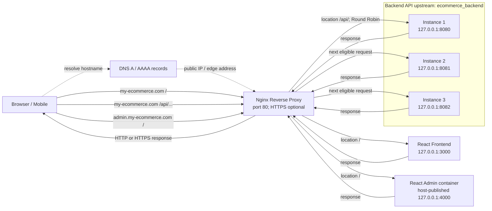

# Bài 6: Load Balancing và Subdomain Routing với Nginx

> Workspace có README và các file cấu hình Nginx tham khảo; không có Docker Compose, Dockerfile, React/Spring source hay runtime để xác nhận cổng/containers. Tên miền, port và backend instance trong bài này là giá trị theo đề bài, không phải kết quả kiểm tra thực tế.

## 1. Mục tiêu bài học

- Route `my-ecommerce.com` và `admin.my-ecommerce.com` theo hostname.
- Chuyển `/api/` qua upstream gồm ba Backend instance, giữ nguyên URI prefix.
- Phục vụ Frontend React và React Admin theo hai origin nội bộ riêng.
- Hiểu Round Robin, passive failure handling, DNS và quy trình reload an toàn.

## 2. Sơ đồ kiến trúc và luồng request



DNS chỉ ánh xạ hostname tới địa chỉ public; Nginx dùng HTTP `Host` để chọn virtual host. Sau khi chọn `my-ecommerce.com`, Nginx dùng `location` để phân biệt API và frontend.

## 3. File cấu hình Nginx hoàn chỉnh

File mẫu trong workspace: [nginx/ecommerce-load-balancing.conf](../nginx/ecommerce-load-balancing.conf). Nội dung cũng được trình bày ở đây để tiện học. Đây không phải file đã cài vào `/etc/nginx`; file có `upstream` và `server` nên phải được include từ bên trong khối `http {}` của Nginx.

```nginx
upstream ecommerce_backend {
    # Chia sẻ trạng thái passive failure giữa các worker Nginx.
    zone ecommerce_backend 64k;

    # Không khai báo thuật toán/weight riêng: dùng Round Robin mặc định.
    server 127.0.0.1:8080 max_fails=2 fail_timeout=10s;
    server 127.0.0.1:8081 max_fails=2 fail_timeout=10s;
    server 127.0.0.1:8082 max_fails=2 fail_timeout=10s;
}

server {
    listen 80;
    server_name admin.my-ecommerce.com;

    location / {
        proxy_pass http://127.0.0.1:4000;

        proxy_set_header Host $host;
        proxy_set_header X-Real-IP $remote_addr;
        proxy_set_header X-Forwarded-For $proxy_add_x_forwarded_for;
        proxy_set_header X-Forwarded-Proto $scheme;
    }
}

server {
    listen 80;
    server_name my-ecommerce.com;

    # Không đưa URL /api (thiếu dấu / cuối) sang Frontend.
    location = /api {
        return 404;
    }

    location /api/ {
        # Không có URI suffix nên giữ nguyên /api/... tới backend.
        proxy_pass http://ecommerce_backend;

        proxy_set_header Host $host;
        proxy_set_header X-Real-IP $remote_addr;
        proxy_set_header X-Forwarded-For $proxy_add_x_forwarded_for;
        proxy_set_header X-Forwarded-Proto $scheme;
    }

    location / {
        proxy_pass http://127.0.0.1:3000;

        proxy_set_header Host $host;
        proxy_set_header X-Real-IP $remote_addr;
        proxy_set_header X-Forwarded-For $proxy_add_x_forwarded_for;
        proxy_set_header X-Forwarded-Proto $scheme;
    }
}
```

Mẫu trên dùng HTTP cổng `80` theo đề bài. Để dùng HTTPS, cần certificate bao gồm đúng hostname và các `server` block `listen 443 ssl` tương ứng; không bật HTTPS với đường dẫn chứng chỉ giả hoặc chưa tồn tại.

### Cấu trúc Nginx

- `http {}` là ngữ cảnh cấu hình HTTP chính trong `nginx.conf`; các `upstream` và `server` ở mẫu phải nằm trong ngữ cảnh này.
- `upstream ecommerce_backend {}` định nghĩa nhóm backend có tên để `proxy_pass` tham chiếu.
- `server {}` định nghĩa virtual host theo port và hostname.
- `location {}` chọn xử lý theo URI trong một virtual host.

Ubuntu thường include `sites-enabled/*` bên trong `http {}`; file thực tế thường được đặt trong `sites-available/` rồi bật bằng symlink `sites-enabled/`. Cách include có thể khác theo cài đặt. Không dán toàn bộ mẫu vào `/etc/nginx/nginx.conf`, không đặt `upstream`/`server` sai ngữ cảnh, và kiểm tra `nginx -T` trước để tránh trùng `upstream ecommerce_backend` hoặc `server_name`.

### Port và container boundary

`127.0.0.1` luôn là loopback của tiến trình đang kết nối. Nếu Nginx chạy trực tiếp trên VPS, `127.0.0.1:4000` chỉ tới được React Admin khi container publish port 4000 lên host loopback, chẳng hạn bind `127.0.0.1:4000:4000`. Không publish cổng admin ra Internet nếu không cần.

Nếu Nginx chạy trong container riêng, `127.0.0.1:4000` là chính container Nginx, không phải host hay container Admin. Đặt các container vào cùng Docker network và dùng service DNS name/port nội bộ, ví dụ `http://react-admin:4000`; tương tự, backend có thể dùng tên service thay cho host ports. Xác nhận port lắng nghe, bind address, network policy và DNS thực tế trước khi dùng các địa chỉ này.

## 4. Upstream và Round Robin

Round Robin là cơ chế lần lượt chọn peer tiếp theo còn khả dụng. Với ba server có weight mặc định bằng nhau, các request được gửi lần lượt qua instance 1, 2, 3 rồi lặp lại. Đây là cấu hình đơn giản, dễ quan sát và phù hợp khi ba instance có năng lực tương đương.

Round Robin **không đảm bảo mọi instance luôn nhận chính xác một phần ba tải**:

- Thứ tự áp dụng theo request/upstream selection, không theo số người dùng hay CPU.
- Request có thời gian xử lý, payload và chi phí khác nhau; cùng số request không đồng nghĩa cùng CPU hoặc throughput.
- Server tạm unavailable, retries, weights, restart và phân phối giữa worker đều làm số request thực tế khác nhau.
- Nhiều request từ cùng một client không mặc định được giữ cùng một instance; nếu có session state trong memory, nên chuyển sang stateless/shared session hoặc thiết kế affinity có chủ đích.

Cân nhắc `least_conn` khi request có thời gian xử lý rất khác nhau hoặc có kết nối dài: Nginx chọn peer có ít active upstream connections hơn. Nó không đo CPU hay thời gian xử lý nghiệp vụ. Các lựa chọn như `ip_hash`/hash có affinity riêng và có thể phân phối lệch (ví dụ nhiều client cùng NAT); chỉ dùng khi có lý do và đã chấp nhận trade-off.

Thêm instance có thể tăng năng lực xử lý nếu backend là nút thắt và tài nguyên được scale cùng. Nó không tự giải quyết giới hạn database, connection pool, lock, cache, network, rate limit, downstream payment provider hoặc một Gateway/Nginx đơn lẻ. Cần đo và kiểm tra bottleneck đầu-cuối.

## 5. Khi Backend `127.0.0.1:8080` bị lỗi

Nginx Open Source dùng **passive health checking**: nó quan sát kết quả các lần proxy thật. Trong mẫu, `max_fails=2` nghĩa là cần đạt ngưỡng hai lần giao tiếp thất bại trong khoảng `fail_timeout=10s`; khi đó peer có thể bị coi là unavailable tạm thời trong khoảng 10 giây rồi được thử lại. Đây không phải probe chủ động tới `/health` theo lịch.

Cụ thể:

- Lỗi kết nối, timeout hoặc response/header failure có thể góp phần vào trạng thái fail theo điều kiện Nginx và `proxy_next_upstream` đang dùng.
- Request đầu tiên khi instance vừa chết vẫn có thể gặp lỗi. Retry sang peer khác có thể giúp một số request, nhưng không đảm bảo thành công trong mọi trường hợp; việc đánh dấu unavailable chỉ xảy ra sau ngưỡng failures.
- Sau thời gian unavailable, Nginx thử dùng peer trở lại. Nếu instance chưa khỏe, request lại có thể lỗi rồi peer bị đánh dấu lại.
- `zone ecommerce_backend 64k` chia sẻ trạng thái upstream giữa worker processes; không thay thế active health check.
- `max_fails=2 fail_timeout=10s` chỉ là ngưỡng ví dụ cho lab; production cần chọn theo traffic và thời gian phục hồi mong muốn. Khi không có request tới peer, passive checking không tự phát hiện peer vừa chết.
- HTTP `500`, `404`, `401` thường là phản hồi nghiệp vụ/ứng dụng, không tự động chứng minh tiến trình đã chết. Chỉ thêm các status vào retry/failure policy khi hiểu rõ semantics.

Nginx Open Source không mặc định gửi health-check request định kỳ. Nếu cần active checks, cân nhắc NGINX Plus, load balancer/orchestrator có readiness probe, hoặc hệ thống health monitoring phù hợp.

Mẫu không bật thêm retry rule. Nginx `proxy_next_upstream` mặc định xử lý một số điều kiện `error` và `timeout`; nếu thay đổi directive này, hiểu rõ điều kiện, `proxy_next_upstream_tries`/timeout và method. Request non-idempotent như POST thường không được chuyển sang peer khác sau khi đã gửi tới upstream, trừ khi cấu hình `non_idempotent`; không bật cơ chế đó cho tạo đơn/thanh toán nếu chưa có idempotency key và thiết kế chống xử lý trùng. Retry lỗi kết nối trước khi request được gửi cũng khác retry sau khi backend có thể đã thực thi thao tác.

## 6. DNS và Subdomain Routing

- `my-ecommerce.com` cần A record trỏ tới IPv4 public của máy chủ/edge. `admin.my-ecommerce.com` cũng cần record phù hợp; có thể dùng A, AAAA hoặc CNAME tùy DNS provider.
- Nếu có AAAA, địa chỉ IPv6 và listener/firewall phải phục vụ đúng máy. Record sai có thể khiến một số client kết nối nhầm nơi.
- Nếu dùng CDN, DNS proxy hoặc external load balancer, DNS phải trỏ đến dịch vụ đó và dịch vụ phải forward traffic tới đúng Nginx/port. Cấu hình client IP thực cần chỉ tin proxy đáng tin cậy.
- HTTP cần TCP `80` được phép tại firewall VPS và firewall nhà cung cấp. HTTPS cần TCP `443` cùng chứng chỉ có SAN bao gồm hostname tương ứng.
- `server_name` chỉ giúp Nginx chọn virtual host từ hostname trong request; nó không tạo DNS record và không làm cổng/container tự hoạt động.

## 7. Triển khai và kiểm thử an toàn

Các lệnh sau là hướng dẫn để bạn tự chạy trên VPS. Không có tiến trình nào được kiểm tra hoặc thay đổi từ workspace; dùng endpoint thật và chỉ tiếp tục khi các điều kiện phù hợp.

1. **Kiểm tra từng backend instance:**

   ```bash
   curl -i http://127.0.0.1:8080/
   curl -i http://127.0.0.1:8081/
   curl -i http://127.0.0.1:8082/
   ```

   `404` vẫn có thể chứng minh có HTTP server trả lời, nhưng cần dùng endpoint thật để kiểm tra chức năng.

2. **Kiểm tra React Admin:**

   ```bash
   curl -i http://127.0.0.1:4000/
   ```

   Lệnh này chỉ áp dụng nếu Nginx chạy trên host và port container đã publish đúng.

3. **Kiểm tra Nginx và cấu hình hiện hữu:**

   ```bash
   sudo systemctl status nginx
   sudo nginx -T
   ```

   Xác nhận các file include, upstream/server names trùng, listener `80/443`, và cách `sites-enabled`/`conf.d` được nạp. Không giả định các port mẫu đang được dùng.

4. **Sao lưu file thực sự sẽ chỉnh.** Ví dụ nếu file site tồn tại:

   ```bash
   sudo cp -a /etc/nginx/sites-available/default "/etc/nginx/sites-available/default.bak.$(date +%Y%m%d-%H%M%S)"
   ```

   Chỉ sao lưu file tồn tại; nếu đang dùng file site khác, sao lưu đúng file đó. Đừng ghi đè cấu hình đang có trước khi đọc.

5. **Tạo/cập nhật cấu hình thủ công sau khi đã review.** File workspace `nginx/ecommerce-load-balancing.conf` chưa được Nginx tự nạp. Trên Ubuntu chuẩn, có thể đặt bản đã điều chỉnh vào `sites-available`, rồi chỉ tạo symlink trong `sites-enabled` sau khi chắc chắn không có file/link trùng. Nếu hệ thống include từ `conf.d`, dùng đúng cơ chế hiện tại. Không bật hai file khai báo cùng hostname/upstream.

6. **Kiểm tra cú pháp:**

   ```bash
   sudo nginx -t
   ```

   Nếu lỗi, không reload; sửa đúng file/dòng theo thông báo và chạy lại test.

7. **Chỉ sau khi `nginx -t` thành công mới reload:**

   ```bash
   sudo systemctl reload nginx
   sudo systemctl status nginx
   ```

8. **Kiểm tra route bằng Host header khi DNS chưa sẵn sàng:**

   ```bash
   curl -i -H 'Host: admin.my-ecommerce.com' http://127.0.0.1/
   curl -i -H 'Host: my-ecommerce.com' http://127.0.0.1/
   curl -i -H 'Host: my-ecommerce.com' http://127.0.0.1/api/health
   ```

   Chỉ dùng `/api/health` nếu endpoint đó tồn tại; nếu không, thay endpoint GET/read-only có thật. Lệnh Host header kiểm tra virtual host cục bộ, không kiểm tra DNS hoặc firewall Internet.

9. **Quan sát phân phối request** bằng endpoint GET/read-only thật:

   ```bash
   for i in $(seq 1 9); do
    curl -sS -H 'Host: my-ecommerce.com' 'http://127.0.0.1/api/<endpoint-doc-duoc>'
       printf '\n'
   done
   ```

   Kết quả chỉ thể hiện instance nếu API response/log đã có định danh instance. Nếu không, xem access/application log riêng của từng backend; có thể bật log nhận diện trong môi trường thử nghiệm. Không sửa mã production chỉ để in tên instance.

10. **Kiểm tra DNS/public route và log:** sau khi A/AAAA và firewall đã được xác nhận, thử `curl -i http://my-ecommerce.com/`, `curl -i 'http://my-ecommerce.com/api/<endpoint-doc-duoc>'` và `curl -i http://admin.my-ecommerce.com/`. Thay placeholder bằng endpoint thật trước khi chạy. Theo dõi:

```bash
sudo tail -n 100 /var/log/nginx/access.log
sudo tail -n 100 /var/log/nginx/error.log
sudo journalctl -u nginx --since "10 minutes ago"
```

Xem log backend tương ứng (ví dụ `journalctl` của service hoặc `docker logs` chỉ khi thực tế dùng systemd/Docker). Không tuyên bố test thành công nếu chưa chạy và xem kết quả.

## 8. Lỗi thường gặp

| Hiện tượng                               | Hướng kiểm tra                                                                                                                                      |
| ---------------------------------------- | --------------------------------------------------------------------------------------------------------------------------------------------------- |
| Hostname vào nhầm site/default           | Kiểm tra A/AAAA, `Host` request, `server_name`, listener và server block trùng trong `nginx -T`.                                                    |
| Admin trả 502                            | Nếu Nginx ở host, kiểm tra container đang chạy và port publish `127.0.0.1:4000`; nếu Nginx trong container, dùng service DNS/network thay loopback. |
| API chỉ trả lỗi từ một instance          | Gọi trực tiếp từng instance, so sánh build/config/data, kiểm tra backend logs và health; Nginx Round Robin không sửa lỗi nghiệp vụ.                 |
| 8080 dừng nhưng request đầu lỗi          | Passive check chưa đạt threshold hoặc request đã tới peer; xem error log, fail settings và retry policy. Đây không phải active health detection.    |
| `/api/...` bị trả từ React               | Đảm bảo `location /api/` nằm trong server domain chính và proxy đúng upstream; `location = /api` trong mẫu ngăn bare path rơi vào Frontend.         |
| Cấu hình báo `duplicate upstream/server` | Tìm khai báo trùng trong toàn bộ include bằng `nginx -T`; chỉ để một upstream/server block có hiệu lực cho cùng cấu hình.                           |
| Thay đổi không có hiệu lực               | Xác nhận file đã được include/enable, chạy `nginx -t`, reload thành công, rồi xem `systemctl status` và logs.                                       |

## 9. Kết luận trình bày

“Nginx chọn virtual host theo hostname: `admin.my-ecommerce.com` tới React Admin, còn `my-ecommerce.com` tách `/api/` tới upstream ba instance và `/` tới React. Khi không cấu hình thuật toán khác, Nginx dùng Round Robin; điều này xoay request qua các peer khả dụng chứ không bảo đảm mỗi máy nhận đúng một phần ba CPU hoặc tải. Nginx Open Source phát hiện peer lỗi theo các lần proxy thực tế (`max_fails`/`fail_timeout`), không chủ động health-check định kỳ. Trước production cần xác minh DNS, network/container và config, sao lưu, chạy `nginx -t`, rồi mới reload.”

## Trạng thái bài 6

- **Đã thực hiện trong workspace:** tạo cấu hình Nginx mẫu và tài liệu hướng dẫn/sơ đồ.
- **Chưa xác minh:** DNS, trạng thái Nginx, frontend/admin containers, ba API instance, endpoint health và response distribution.
- **Chưa thực hiện trên VPS:** chưa cài/nạp cấu hình, chưa tạo symlink, chưa reload dịch vụ hoặc gửi request.
- **Trước khi áp dụng:** kiểm tra service/network thật, DNS A/AAAA, cấu hình active/trùng lặp; sao lưu file VPS; chỉ reload sau khi `sudo nginx -t` thành công.
